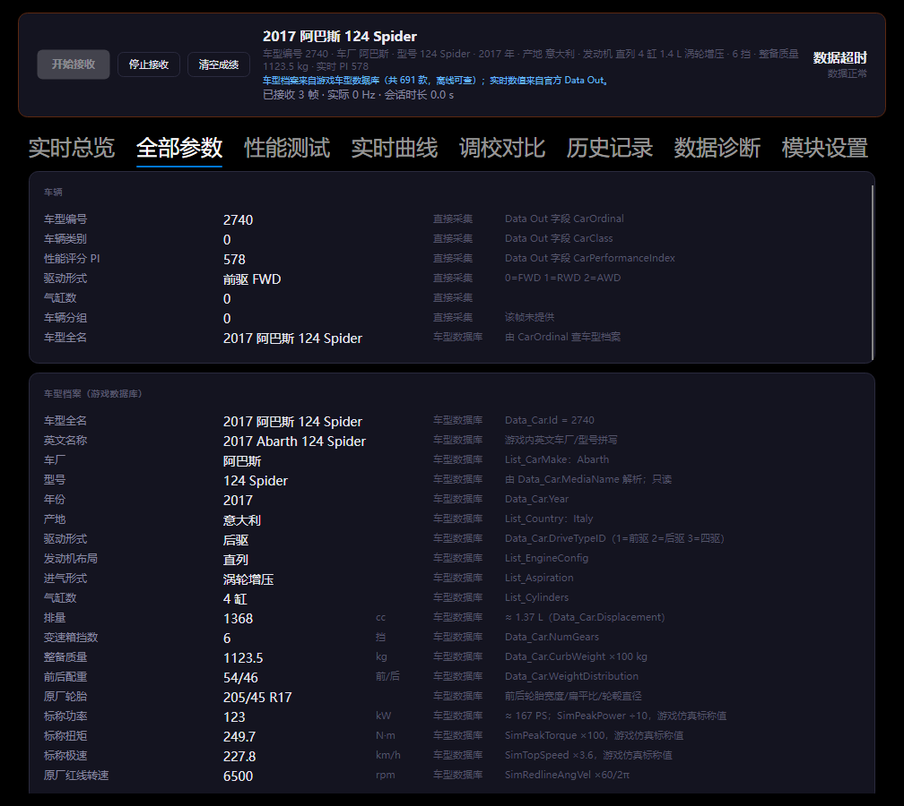

# 车辆性能实测模块说明

该模块可作为 **FH6 遥测助手**独立启动。[独立版使用与构建说明](../README.md)

实时读数来自游戏官方 Data Out，或由报文字段计算。车名和原厂参数来自随程序发布的离线车型副本。助手运行时无需读取游戏数据库或游戏内存。 [官方 Data Out 文档](https://support.forza.net/hc/en-us/articles/51744149102611-Forza-Horizon-6-Data-Out-Documentation)

## 一、数据来源与协议

- 协议：Forza Data Out（Horizon 格式，**324 字节**，Sled + Dash + Horizon 扩展），小端序。
- 接收：UDP，默认 `127.0.0.1:20440`，后台异步任务接收，不阻塞 UI。
- 字段偏移见 [Data Out 解析源码](../Core/Fh6Telemetry.cs) 的顶部注释。
- 采样率由游戏决定（通常约 60 包/秒）；界面刷新与采样解耦，界面刷新频率不影响计时精度。
- 内置档案收录 **691 款**车。按 Data Out 的 `CarOrdinal` 查到车厂、型号、年份等静态资料。 [车型副本](../Catalog/VehicleCatalogData.g.cs)
- 页面内“数据诊断”标签页显示：收包数、有效包、解析失败、非本机来源、实际频率、最近包长、最近接收时间、数据超时与排查建议。

### 字段可用性清单

| 类别 | 字段 | 来源 |
| --- | --- | --- |
| 车辆 | 车型编号、车辆类别、性能评分 PI、驱动形式、气缸数、车辆分组 | 直接采集 |
| 车辆档案 | 车型全名（含车厂/型号/年份）、英文名称、车厂、型号、年份、产地、原厂驱动形式、发动机布局、进气形式、气缸数、排量、变速箱挡数、整备质量、前后配重、原厂轮胎规格、标称功率/扭矩/极速、原厂红线转速 | 内置车型档案 |
| 运动 | 速度（m/s，界面换算 km/h / mph）、行驶距离、位置 X/Y/Z、四元姿态 Yaw/Pitch/Roll | 直接采集 |
| 运动 | 纵向/横向/垂直加速度（m/s²）、角速度 | 直接采集 |
| 计算 | 纵向 G、横向 G、垂直 G、合成 G、偏航/俯仰/侧倾角速度（°/s）、速度差分加速度 | 由加速度与角速度换算 |
| 发动机 | 转速、最大转速、怠速转速、功率（W）、扭矩（N·m）、增压压力、燃油余量 | 直接采集 |
| 计算 | 功率 hp / PS、扭矩 lb-ft、转速百分比 | 单位换算 |
| 传动 | 挡位、油门、刹车、离合、手刹、归一化转向输入 | 直接采集 |
| 轮胎 | 四轮纵向滑移、侧向滑移、综合滑移（归一化）、轮速、胎温（单点）、路肩、积水与路面振动 | 直接采集 |
| 悬挂 | 四轮悬挂行程（米）、归一化行程 | 直接采集 |
| 比赛 | 当前圈、名次、本圈/上圈/最佳圈时间、比赛总时间 | 直接采集 |
| 估算 | 车身侧滑角（四轮胎滑移角平均）、转向角（归一化输入 × 设定最大转向角） | 估算，界面标注“估算” |
| 暂不支持 | 发动机水温/油温、发动机负载百分比、胎压、胎温三分区、实际齿比与终传比、前后轴扭矩分配、四轮载荷 | Data Out 不提供 |

## 二、界面结构

| 标签 | 内容 |
| --- | --- |
| 自动换挡 | 新手引导、输入模式、时序、换挡策略与换挡原因 |
| 实时总览 | 顶部显示完整车型名称与档案摘要（车厂、型号、年份、产地、发动机、挡数、整备质量、实时 PI）；速度表（环形仪表 + 最高速标记）、转速表（含红线区）、挡位大字、油门/刹车条、功率/扭矩/峰值、纵向/横向/合成 G、驾驶状态、测试状态 |
| 全部参数 | 车辆、原厂参数（内置车型档案）、运动、发动机、传动与操控、轮胎（四轮）、悬挂与底盘、圈速八组，逐项标注来源 |
| 性能测试 | 启用的测试项目、自定义加速/制动/距离、成绩汇总（最佳/最近/平均/次数）、结束极速测试 |
| 实时曲线 | 速度、功率/扭矩、加速度、驾驶输入四张曲线，时间窗口可调，支持暂停/清空，悬停十字光标显示精确采样 |
| 调校对比 | 保存当前参数快照；选择两条历史记录生成对比（用时差、峰值功率/扭矩/速度/G、车辆与 PI 变化提示） |
| 历史记录 | 搜索、按车辆筛选、导出 CSV/JSON、生成 HTML 报告、备份数据、打开数据目录、编辑备注、删除 |
| 数据诊断 | 采集计数、频率、解析失败、超时状态、协议信息、导出诊断日志、清空计数、排查建议 |
| 模块设置 | 监听地址/端口、速度/功率/扭矩单位、界面刷新率、平滑系数、最大测试时长、自动保存、数据目录 |
| HUD 设置 | HUD 显示项目、位置、尺寸和不透明度 |
| 测试功能 | 自适应车速匹配、严格按照速度与档位匹配、转速匹配保护、漂移模式、升挡抓地保护 |
| 虚拟手柄配置 | 驱动安装、HidHide 放行路径、键位、排查和恢复 |

### 车型档案与车辆识别

- **识别方式**：Data Out 的 `CarOrdinal` 与游戏数据库 `Data_Car.Id` 是同一编号空间。收到第一帧数据后，用该编号在离线车型目录中查询，得到完整车型名称与档案；换车（编号变化）时自动切换，测试引擎同时清空上一辆车的进行中成绩。
- 页面顶部显示年份、车厂和型号，例如“2017 阿巴斯 124 Spider”。下一行显示档案摘要和实时 PI。「全部参数」的「原厂参数（内置车型档案）」列出英文名称、原厂配重、轮胎规格和标称动力等。
- 当前副本来自已有的离线车型导出。更新工具读取指定目录下现成的 `Data_Car_c0.tsv`，并使用本地映射补全名称。部分中文名称和特殊版本缩写可能与游戏界面略有不同。 [离线目录生成脚本](../tools/generate_car_catalog.py)
- **标称功率/扭矩/极速/红线**是游戏数据库里的仿真/展示值（`SimPeakPower ÷10 = kW`、`SimPeakTorque ×100 = N·m`、`SimTopSpeed ×3.6 = km/h`、`SimRedlineAngVel ×60/2π = rpm`），只用于识别车型，**不是本次实测数据**；实测以 Data Out 的实时峰值为准。
- 新版本、DLC 或特殊车辆的编号如果还没收录，标题栏显示“车型 编号”，实时字段继续更新。
- **历史与对比**：新记录会保存完整车名；旧版本记录（未保存车名）在列表、筛选、对比和导出时按编号自动补全，因此历史记录不再出现“车型 编号”的空白名称。

## 三、性能测试引擎

支持自动触发、自动计时、自动保存，全部基于**数据包时间戳**并对阈值穿越做线性插值（不用 UI 刷新次数计时，精度受游戏约 60 Hz 采样限制）。

| 类型 | 项目 |
| --- | --- |
| 加速 | 0–60、0–100、0–160、0–200、0–300、60–100、80–120、100–200、100–300 km/h，以及自定义区间 |
| 制动 | 60–0、100–0、120–0、200–0 km/h，以及自定义起始速度 |
| 距离 | 0–100 m、0–200 m、0–400 m、0–1/4 英里（402.336 m）、0–800 m、0–1 英里（1609.344 m），以及自定义距离 |
| 极速 | 记录本次最高速度、达到该速度的时间与距离、峰值功率/扭矩/转速、终点挡位（手动点击“结束极速测试”生成成绩） |

状态机：`待机 → 等待起步条件 → 测试进行中 → 完成 / 超时 / 中断失效`。数据中断超过 2 秒、换车、超过最大测试时长都会使进行中的测试作废，不会产生伪造成绩。

## 四、数据存储与导出

- 独立版的默认目录为 `%APPDATA%\FH6Telemetry\telemetry`，使用便携配置时保存在 EXE 旁的 `Data\telemetry`。需要复制旧修改器的遥测记录时，按独立版说明手动导入。 [独立版数据位置](../README.md#使用)
  - `records.json`：版本化索引（SchemaVersion=1），原子写入（临时文件 + 替换）；
  - `samples\<记录ID>.csv`：该次测试的原始采样（时间、速度、转速、功率、扭矩、油门、刹车、离合、转向、挡位）；
  - 导出：`export-*.csv` / `export-*.json` / `report-*.html`（HTML 可直接在浏览器打印为 PDF）；
  - 备份：`backup-<时间戳>\`。
- 保留策略：超过“最大记录数”（默认 500）时删除最旧记录及其采样文件，避免无节制增长。
- 异常安全：索引写入失败不会破坏已有文件；采样文件缺失时诊断会显示缺失条数。

> 未采用 SQLite：主工程当前不引用 Microsoft.Data.Sqlite，引入会带来约 10 MB 原生依赖并影响单文件发布体积；本模块数据量级（数百条记录 + 独立采样文件）用版本化 JSON 索引完全够用，且便于用户直接备份与查看。

## 五、录制与回放

- 录制：接收状态下自动记录原始采样（每次测试完成时随记录保存最近约 40 秒原始数据）。
- 回放：在“历史记录”中选择记录 → 查看其采样文件（CSV）；模块内的图表回放能力基于同一份采样数据实现，回放数据在界面中明确标注为历史数据，不会与实时数据混淆。
- 由于当前版本未实现独立的回放播放器 UI，历史数据的可视化以 CSV 与 HTML 报告形式提供；后续可在不改动数据模型的前提下增加播放器。

## 六、估算与未标定项

- 侧滑角、转向角为**估算值**（界面标注“估算”），不是车辆真实姿态角。
- 功率为游戏输出的**发动机输出功率**（轴功率口径），不是轮上功率，也不是标称功率；三者不可混用。
- 制动距离由游戏累计里程差得到，受采样率限制。
- 0–100 等成绩从约 1 km/h 起计（官方口径），与从静止起的实测值会有约 0.03–0.05 秒差异。

## 七、测试与验证

- `Tests/FH6Telemetry.Tests.csproj` 覆盖 324 字节包解码、性能计时、记录导出、UDP 回环、已知和未收录车型，以及驾驶辅助和换挡逻辑。
- 加 `-- --ui` 运行独立窗口测试，使用模拟 Data Out 验证实时车型、HUD、快捷键和驾驶辅助。预览图保存在测试输出目录的 `ui-preview`。 [独立测试命令](../README.md#独立测试)
- 需要真实游戏环境验证的部分：真实采样率下的计时精度、长时间运行的内存稳定性、实际车辆的估算字段合理性、新版本/DLC 车辆是否被车型目录收录。

## 八、常见问题

| 现象 | 处理 |
| --- | --- |
| 显示“监听失败” | 端口被占用（另一个修改器实例/其他程序），换端口或关闭占用程序；修改端口后先“停止接收”再“开始接收”。 |
| 一直“等待数据” | 游戏内“设置 → HUD 和游戏性 → 数据输出”未开启或端口不一致；必须处于驾驶画面（暂停菜单/车库可能不发送）。 |
| “数据超时” | 超过设定时间（默认 3 秒）没有收到包，检查游戏是否暂停、端口是否被占用。 |
| 解析失败数持续增长 | 协议版本不同；记录页面显示的包长与失败计数并反馈。 |
| 测试不触发 | 确认对应测试项目已启用，且车辆从静止起步（加速类）或从高于阈值速度开始减速（制动类）。 |
| 想比较调校前后 | 先用“保存当前车辆参数快照”，完成原厂测试，修改车辆参数并重新载入车辆后再跑同一测试，最后在“调校对比”中选择两条记录生成对比。 |
| 标题栏只显示“车型 编号” | 内置车型档案尚未收录这个编号。Data Out 实时字段仍正常显示。更新档案后即可显示新车名。 |

## 九、自动换挡

在 FH6 开启 Data Out，填写与「模块设置」相同的 IP 和端口，选择手动换挡，按所选输出方式核对游戏内绑定。「虚拟手柄配置」页提供驱动安装、放行路径和按钮对应关系。「升降挡键按住时长」默认 120 ms，可设为 50–250 ms。「换挡延迟」可填写 0–900 ms，表示发出指令到遥测确认新挡位的时间。留空自动估计，用于预测换挡。[独立版输入配置](../README.md#使用) · [FH6 Data Out](https://support.forza.net/hc/en-us/articles/51744149102611-Forza-Horizon-6-Data-Out-Documentation)

- **LazyForza** 是默认策略，使用相邻挡同车速下的轮上扭矩交点。油门接近全开时，按实测限转或动力衰减判断升挡时机。「实测动力衰减」侧重稳定油门下的功率与扭矩掉落。[LazyForza ShiftPointCalculator](https://github.com/Laz22y/LazyForza/blob/f40d4230abaa47c9f3ec7c026861aa614b7105ba/src/LazyForza.Analysis/ShiftPointCalculator.cs)
- **LazyForza 的动力和挡位学习**油门至少 90%、车速至少 36 km/h，且相邻遥测帧保持同挡。程序滤除离合、明显打滑、碰撞和位置跳变，用 200 RPM 区间的扭矩中位数和实测挡位比计算推荐。换车或检测到调校变化时重新学习。[LazyForza ShiftLearner](https://github.com/Laz22y/LazyForza/blob/f40d4230abaa47c9f3ec7c026861aa614b7105ba/src/LazyForza.Analysis/ShiftLearner.cs)
- **Virtual TCU** 提供舒适、竞技、漂移和越野四个模式。舒适跟随踏板和驾驶风格，竞技在制动或深踩油门时选择合适的低挡，漂移维持所需转速，越野着重保留扭矩。[Virtual TCU 换挡逻辑](https://github.com/Forza-Love/fh6-virtual_tcu/blob/8c27ac99ef75d5ad558ae62e138c58d8080d8c61/virtual_tcu/logic/tcu.py#L2018)
- **FH6 Auto Shift** 按当前车辆的实测断油点、相邻挡功率交点和换挡延迟升挡。制动、滑行、出弯或深踩油门时，依据已学习的挡位比预测低一挡接合转速。设置会记住所选策略，动力数据在本次驾驶中从 Data Out 学习。[FH6 Auto Shift 换挡逻辑](https://github.com/ufsemmc/fh6-auto-shift/blob/505fe620a9771dcc0967e7b17fe606061511e233/fh6_auto_shift.py#L5544)
- **换挡模式5**比较升挡前后的实测功率。下一挡更有力时提前升挡，动力持续上升时接近断油再升挡。降挡时估算低一挡的接合转速。
- **自动离合与赛用变速箱识别**。所有策略共用「自动离合」（默认开启），关闭后助手只发升挡和降挡键。开启「智能识别赛用变速箱」后，助手会监听手动升挡，也会在首个合适的自动升挡时尝试免离合。识别出赛用变速箱后免离合，常规变速箱使用离合。每次换车、改调校或遥测中断后重新校准，连续驾驶同一辆车时开关自动换挡会沿用当前判定。
- **驾驶快捷键**。在「快捷键」页可为自动换挡、驾驶辅助、自动离合、HUD 与行驶记录分别绑定键盘和手柄按键。保存并启用后，在游戏前台按一次触发。换挡绑定同时显示在 HUD 的自动换挡状态旁。[配置和排错](fh6-telemetry-agent-setup.md)
- **降挡补油与发动机制动**：内置手柄模式下所有策略都会按当前转速与预计接合转速的差值、按键时长及实际接合转速闭环校准补油量，低速爬行或无需抬转时不发多余补油。制动降挡在油门收回且制动达到 10% 时开始判断，优先选择轮上负扭矩更强的低挡；当车速与动力曲线齐备时还会参考实测峰值区间，并在转速跌出可用动力带时主动回挡准备出弯。
- **驾驶意图引擎与全策略综合判断**：内置 `DriverIntentAnalyzer` 与扩展后的 `ShiftDynamics` 会融合踏板踩下/松开速率、弯道横向负载与回正速率（`SteerRate`）、坡度估计（`RoadGrade = VelocityY / Speed`）、路面颠簸/积水、涡轮增压（`BoostPsi`）、轮胎侧滑与反打方向角识别当前驾驶意图（如 `入弯收油`、`重刹入弯`、`循迹刹车`、`弯中稳油`、`出弯加速`、`漂移`、`越野`），并同步驱动所有 5 种换挡策略：入弯快收油及弯中/主动漂移时暂缓低负荷误升挡（真实触及断油红线仍保护升挡），上下坡自动延迟升挡或增强滑行/制动发动机制动，出弯回正方向时放宽横向过弯降挡门限，循迹/轻微锁死制动时适当平滑补油并显示实时 HUD 意图标签。
- **HUD 扩展遥测细节**：驾驶 HUD 在原有车速、挡位、升降挡箭头与动态红线变色转速条基础上，新增「油门/刹车竖条」（类似手机电量的红绿细竖条与实时百分比）以及「驾驶细节与意图」底栏（居中双向转向指示条、纵向/横向 G 值、实时功率与涡轮增压值、离合/手刹/打滑状态和识别到的驾驶意图徽标），各项均可在「HUD 设置」独立开关并实时预览。
- **测试功能**包含自适应车速匹配、严格按照速度与档位匹配、转速匹配保护、漂移模式和升挡抓地保护。自适应车速匹配结合实体油门与刹车判断驾驶意图，深踩油门或拖挡时优先匹配高动力的安全挡位。升挡抓地保护开启后，明显打滑、横向负荷较高或转速比不稳定时暂缓升挡。
- **严格按照速度与档位匹配**默认关闭，开启后优先于原策略、自适应车速匹配和漂移模式。以实际车速推算转速，当前挡达到最高转速的 90% 时考虑升挡，低一挡预计处于最高转速的 72% 以内时考虑降挡。降挡仍会核对实测发动机转速和可用轮速，预计超转时持挡。每次发出一个换挡指令，等游戏确认后再计算。
- **LazyForza 和实测动力衰减的普通降挡**沿用 LazyForza 的建议。当前转速低于升入该挡时预计接合转速的 90% 时，检查目标挡的接合转速并降一挡。界面会显示降挡箭头、目标挡和预计接合转速。[LazyForza DashboardHudState](https://github.com/Laz22y/LazyForza/blob/f40d4230abaa47c9f3ec7c026861aa614b7105ba/src/LazyForza.Modules.Dashboard/DashboardHudState.cs)
- **LazyForza 和实测动力衰减的制动降挡**在油门收回、制动达到 10% 时开始判断。以 LazyForza 换挡点为参考，结合制动量、实测减速度、横向负荷和换挡延迟计算接合转速。接合转速受实测限转或 Data Out 转速上限约束，判断超转风险时也会检查当前车速。[制动换挡研究](https://saemobilus.sae.org/papers/research-shift-control-strategy-braking-conditions-automatic-transmission-vehicles-based-fuzzy-inference-2014-01-1742)
- **发动机制动**收油时学习负扭矩，样本齐备时比较各挡预计轮上制动力。负扭矩样本不足时，按已学习的挡位比和接合转速择机降挡。助手用驱动轮转速补学短暂打滑的挡位，再用车速计算预计接合转速。
- **样本不足和实际限转**缺少可用的相邻挡换挡点时，按动力衰减、实际限转、制动和低速回挡等规则工作。直线全油门时反复出现的动力中断可以识别 Data Out 最大转速之前的实际限转。
- **连续换挡**逐挡确认实际挡位，两次手柄按键之间留出至少 20 毫秒的松键时间，让游戏识别两次独立按键。各策略根据制动和前一次换挡分别控制换挡间隔。
- **键盘模式**通过 Raw Input 区分实体按键与程序发出的按键。玩家按住油门时省略补油，换挡过程中按住的实体键会继续保持。带离合时先踩离合，25 毫秒后按换挡键，随后先松换挡键，再经 10 毫秒松开补油和离合。无法注册 Raw Input 时回退到常规键盘状态检查。[Microsoft Raw Input](https://learn.microsoft.com/en-us/windows/win32/inputdev/raw-input)
- **挡位保护**在倒挡或空挡时保持手动操作，切回前进挡并稳定后恢复。手动换挡优先，失焦和遥测中断时松开自动输入。接近停稳后，各策略逐挡退回一挡，每次等当前挡位确认并松开上一组按键。撞停前发送且未确认的旧请求到期时会让位给低速恢复。恢复指令本身超时会停用自动换挡。
- **碰撞与动力恢复**结合速度和加速度突变、碰撞字段、踏板、转速和扭矩推断。官方 Data Out 提供这些信号，未提供赛事处罚状态。检测到撞击或持续动力受限时，暂时持挡并隔离这段学习样本。车身稳定和动力恢复后重新判断换挡。 [官方 Data Out 字段](https://support.forza.net/hc/en-us/articles/51744149102611-Forza-Horizon-6-Data-Out-Documentation)
- **滞空保护**默认开启，可在「自动换挡」页与「起步打滑保护」相邻的位置切换。所有策略在车辆离地时都会释放待确认的自动输入，落地并稳定后恢复判断。LazyForza 在持续深踩油门且有安全的低挡时逐挡降挡。侧滑或打转时会用车速、发动机转速和可用轮速估算下一挡。转速余量不足或缺少可靠的挡位数据时会先持挡。
- **最高前进挡**自动模式逐挡发出升挡请求并用 Data Out 确认，上限十挡。未观察到的高一挡两次未确认后，暂以当前挡为上限，继续允许降挡。手动挂入更高挡会更新上限。填写具体挡数时使用手动上限。

## 十、缓存与成绩保留

| 配置 | 最长时间 | 最多帧数 |
| --- | --- | --- |
| 极致性能 | 15 秒 | 600 帧 |
| 性能 | 30 秒 | 1800 帧 |
| 平衡 | 90 秒 | 6000 帧 |
| 数据细节 | 300 秒 | 24000 帧 |
| 自定义 | 1–600 秒 | 10–60000 帧 |

曲线和采样明细同时受时长及帧数限制。在「模块设置 → 缓存与成绩保留」可立即清空实时曲线和闲置临时采样，也可按保存的间隔定时清空。行驶记录、正在进行的性能测试采样和设置均会保留。成绩限时清理有独立开关。

曲线刷新保留峰值和谷值，参数页复用已有行，录制直接写入压缩日志。换挡和驾驶辅助仍按原始遥测帧计算。
